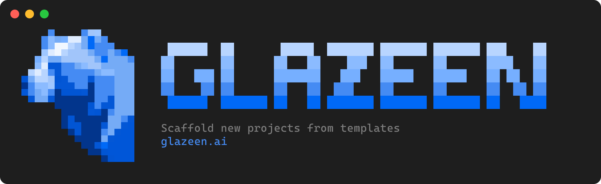

<div align="center">
  <br />
  
  <h1>Glazeen CLI</h1>
  <p>Scaffold new projects from the official Glazeen templates or from your own template repositories.</p>
  <p>
    <a href="https://www.npmjs.com/package/@glazeen/cli"></a>
    
    
  </p>
  <p>
    <a href="https://glazeen.ai">Website</a> ·
    <a href="#quick-start">Quick start</a> ·
    <a href="#using-your-own-templates">Use your own templates</a>
  </p>
  <br />
</div>

---

## Contents

- [Quick start](#quick-start)
- [Commands](#commands)
- [Template sources](#template-sources)
- [Using your own templates](#using-your-own-templates)
  - [1. Create a template](#1-create-a-template)
  - [2. Try it locally](#2-try-it-locally)
  - [3. Publish it to a repository](#3-publish-it-to-a-repository)
  - [4. Make it your team's default (optional)](#4-make-it-your-teams-default-optional)
- [`glazeen.config.json` reference](#glazeenconfigjson-reference)
  - [Optional files](#optional-files)
- [Writing template files](#writing-template-files)
- [Troubleshooting](#troubleshooting)

## Quick start

**Requirements:** Node.js 20.12 or newer, and [Git](https://git-scm.com/) for remote templates.

Create a project; no installation needed:

```bash
npm create glazeen@latest my-app
# or: pnpm create glazeen my-app · yarn create glazeen my-app · npx glazeen create my-app
```

You'll be asked to pick a template and answer its questions. The CLI then creates `./my-app`, runs the template's setup commands (e.g. `pnpm install`), and prints the next steps.

The examples below use `npx glazeen`. You can also install the CLI globally, which adds the `glazeen` command:

```bash
pnpm add -g glazeen   # or: npm install -g glazeen
glazeen create my-app
```

<details>
<summary>About the npm packages</summary>

| Package                                                          | Use it with                         |
| ---------------------------------------------------------------- | ----------------------------------- |
| [`@glazeen/cli`](https://www.npmjs.com/package/@glazeen/cli)     | `npx glazeen create my-app`    |
| [`glazeen`](https://www.npmjs.com/package/glazeen)               | `npx glazeen create my-app`         |
| [`create-glazeen`](https://www.npmjs.com/package/create-glazeen) | `npm create glazeen@latest my-app`  |

They're released together with the same version: `glazeen` and `create-glazeen` only run `@glazeen/cli`. With `npm create`, pass options after `--`: `npm create glazeen@latest my-app -- -t my-org/my-templates`.

</details>

## Commands

### `create [project-name]`

Creates a new project. If you leave out `project-name`, the CLI asks for it.

```bash
npx glazeen create                                     # fully interactive
npx glazeen create my-app                              # choose a template from a list
npx glazeen create my-app -t express-app               # use an official template
npx glazeen create my-app -t my-org/my-templates       # use your own repository
npx glazeen create my-app -t ./path/to/template        # use a local folder
```

| Option                  | Description                                                                                             |
| ----------------------- | ------------------------------------------------------------------------------------------------------- |
| `-t, --template <name>` | An official template name or any [template source](#template-sources). Skips the template picker.       |
| `--refresh`             | Checks for template updates even if the cache is recent.                    |
| `--verbose`             | Shows detailed logs (cache location, timings, git errors).                                              |

Without `--template`, the list includes an **Other source…** entry where you can enter a repository URL or a local path.

If the target folder already exists and isn't empty, the CLI asks before writing into it.

### `list [source]`

Lists the official templates, or the templates found in a [source](#template-sources).

```bash
npx glazeen list
npx glazeen list my-org/my-templates
```

Supports `--refresh` and `--verbose` like `create`.

### Other

| Command               | Description                         |
| --------------------- | ----------------------------------- |
| `help [command]`      | Shows help for the CLI or a command |
| `-V, --version`       | Prints the CLI version              |

## Template sources

Wherever the CLI accepts a template source (`create -t`, `list`, the **Other source…** prompt), you can use any of these:

| Source                    | Example                                                        |
| ------------------------- | -------------------------------------------------------------- |
| GitHub shorthand          | `my-org/my-templates`                                          |
| Subfolder of a repository | `my-org/my-templates/api-template`                             |
| Branch or tag             | `my-org/my-templates#develop`                                  |
| GitHub URL                | `https://github.com/my-org/my-templates`                       |
| GitHub URL to a folder    | `https://github.com/my-org/my-templates/tree/main/api-template` |
| Any git URL               | `https://gitlab.com/my-org/templates.git`, `git@github.com:my-org/templates.git` |
| Local folder              | `./templates/api`, `../my-templates`, `~/templates`, `C:\templates` |

Notes:

- A source can contain **one template** (a `glazeen.config.json` at its root) or **several templates** (one per direct subfolder, each with its own `glazeen.config.json`). With several, you get a list to pick from.
- Local paths must start with `./`, `../`, `~`, `/` or a drive letter. A plain word like `express-app` is always treated as an official template name.
- Remote sources are cloned with `git`, so **private repositories** work if your git credentials can access them (SSH key, credential manager, or `gh auth setup-git`). The CLI never waits for a password prompt; if it has no access, it fails with git's error message.

## Using your own templates

You don't need to change the CLI to use your own templates. A template is a folder with a `glazeen.config.json` file in it.

### 1. Create a template

```text
my-templates/                  ← a repository with several templates
├── api-template/
│   ├── glazeen.config.json    ← makes this folder a template (not copied)
│   ├── package.json.hbs       ← rendered with the answers → package.json
│   ├── README.md.hbs          ← rendered → README.md
│   ├── .env.example           ← copied as-is
│   └── src/
│       └── index.ts           ← copied as-is
└── web-template/
    ├── glazeen.config.json
    └── ...
```

If the repository has only one template, put `glazeen.config.json` at its root.

A minimal `glazeen.config.json`:

```json
{
  "name": "api",
  "description": "Node.js API with TypeScript",
  "prompts": [
    {
      "key": "project_name",
      "type": "text",
      "message": "Project name?",
      "default": "my-api"
    }
  ],
  "post_create": [
    { "command": "pnpm install", "response_message": "Installing dependencies" }
  ],
  "next_steps": ["pnpm dev"]
}
```

And `package.json.hbs`:

```hbs
{
  "name": "{{project_name}}",
  "version": "0.1.0"
}
```

See the [config reference](#glazeenconfigjson-reference) and [template files](#writing-template-files) sections for everything you can do.

### 2. Try it locally

Point the CLI to the folder while you work on it; nothing has to be pushed:

```bash
npx glazeen list ./my-templates                    # checks that every config is valid
npx glazeen create test-app -t ./my-templates      # runs the full flow
```

`list` reports invalid configs with the exact field that's wrong, so it works as a quick validator.

### 3. Publish it to a repository

Push the folder to GitHub (or any git host), then use it from anywhere:

```bash
npx glazeen create my-app -t my-org/my-templates
npx glazeen create my-app -t my-org/my-templates/api-template   # skip the picker
npx glazeen create my-app -t my-org/my-templates#v2             # a specific branch or tag
```

### 4. Make it your team's default (optional)

Set the `GLAZEEN_TEMPLATES_REPO` environment variable to any [template source](#template-sources). `create` and `list` will then use your repository instead of the official templates:

```bash
# macOS / Linux (e.g. in ~/.zshrc or ~/.bashrc)
export GLAZEEN_TEMPLATES_REPO=my-org/my-templates

# Windows (PowerShell)
setx GLAZEEN_TEMPLATES_REPO "my-org/my-templates"
```

```bash
npx glazeen create my-app -t api    # "api" is now looked up in my-org/my-templates
```

## `glazeen.config.json` reference

| Field         | Type     | Required | Description                                                                          |
| ------------- | -------- | -------- | ------------------------------------------------------------------------------------ |
| `name`        | string   | yes      | Template name shown in lists and used with `-t <name>`.                               |
| `description` | string   | no       | One-line description shown next to the name.                                          |
| `prompts`     | array    | no       | Questions asked before scaffolding (see below).                                       |
| `post_create` | array    | no       | Commands run inside the new project after the files are created.                      |
| `next_steps`  | string[] | no       | Hints shown at the end (`cd <project>` is added automatically).                       |

You can also select a template by its folder name, e.g. `-t express-template`.

### Prompts

Every prompt has:

| Field              | Required | Description                                                                         |
| ------------------ | -------- | ----------------------------------------------------------------------------------- |
| `type`             | yes      | `text`, `confirm`, `select` or `multiselect`                                         |
| `message`          | yes      | The question                                                                        |
| `key`              | no       | Variable name to use in `.hbs` files (letters, digits, `_` and `-`). Without it the answer isn't stored. |
| `default`          | no       | Default answer (see each type below)                                                |
| `choices`          | depends  | Answers and the commands they trigger (see each type below)                         |
| `files`            | no       | Files and folders created only for some answers (see [Optional files](#optional-files)) |
| `response_message` | no       | Label shown while the commands triggered by this prompt run                          |

**`text`**: free text. `default` is used when the user just presses Enter.

```json
{ "key": "port", "type": "text", "message": "Port?", "default": "3000" }
```

**`confirm`**: yes/no. The variable is set to `"Yes"` or `"No"`. `choices.Yes` / `choices.No` hold the commands (a string or an array of strings) to run for each answer. `default` can be `"Yes"` (the default) or `"No"`.

```json
{
  "key": "use_db",
  "type": "confirm",
  "message": "Do you want to use Prisma?",
  "choices": { "Yes": "pnpm exec prisma generate" },
  "files": { "Yes": ["prisma", "prisma.config.ts"] },
  "response_message": "Generating the Prisma client"
}
```

**`select`**: pick one option. `choices` is a list of `{ "<label>": <command(s)> }` objects. The variable is set to the selected label. `default` is the label selected initially.

```json
{
  "key": "orm",
  "type": "select",
  "message": "Which ORM?",
  "choices": [
    { "prisma": "pnpm add prisma" },
    { "drizzle": ["pnpm add drizzle-orm", "pnpm add -D drizzle-kit"] },
    { "none": [] }
  ],
  "default": "prisma"
}
```

**`multiselect`**: pick any number of options. Same `choices` format as `select`. The variable is a **list** of the selected labels, and the commands of every selected option run. `default` is a comma-separated list of labels selected initially (e.g. `"eslint,prettier"`).

### Optional files

Some files only belong in the project for some answers, e.g. the `prisma/` folder and `prisma.config.ts` when a database is used. List them in the prompt's `files`, under the answer that needs them, the same way `choices` lists commands:

```json
{
  "key": "use_db",
  "type": "confirm",
  "message": "Do you want to use a database?",
  "files": { "Yes": ["prisma", "prisma.config.ts"] }
}
```

- Files listed under an answer are created only when that answer is picked. All other files are always created.
- Paths are relative to the template folder and use `/` (e.g. `packages/database/prisma`). A folder includes everything inside it.
- `prisma.config.ts` also matches `prisma.config.ts.hbs`.
- A single path can be a string: `"files": { "Yes": "prisma" }`.
- `confirm` prompts use `Yes` and `No` as answers, `select` and `multiselect` prompts use their choice labels. With `multiselect`, the files of every selected label are created:

```json
{
  "key": "features",
  "type": "multiselect",
  "message": "Which extras?",
  "choices": [{ "ESLint": "pnpm add -D eslint" }, { "Docker": "" }],
  "files": { "ESLint": "eslint.config.js", "Docker": ["Dockerfile", "docker"] }
}
```

- If several prompts list the same path, it's created only when all of them pick it.
- `list` reports paths that don't exist in the template and answers that aren't choices of the prompt, so typos are caught early.

### Post-create commands

```json
"post_create": [
  { "command": "pnpm install", "response_message": "Installing dependencies" },
  { "command": "git init && git add -A && git commit -m \"Initial commit\"" }
]
```

- Commands run in the new project folder through your shell, so `&&`, quotes and environment variables work.
- The `post_create` commands run first, followed by commands triggered by prompts, in prompt order.
- Live output is shown while a command runs. If a command fails, its full output stays visible, the remaining commands are skipped and listed under **Next steps** so you can run them yourself, and the CLI exits with code 1. The project files are kept.
- Commands can't read from the keyboard, so avoid commands that ask questions (pass flags such as `--yes` instead).

## Writing template files

- Every file and folder is copied into the new project, except `glazeen.config.json`, `.git`, `node_modules` and the [optional files](#optional-files) of answers that weren't picked.
- Files ending in **`.hbs`** are rendered with [Handlebars](https://handlebarsjs.com/guide/) and saved without the `.hbs` extension (`README.md.hbs` → `README.md`). Every prompt `key` is available as a variable.
- Values are inserted **as-is** (no HTML escaping), so `{{project_description}}` outputs `Tom's API & tools` exactly as typed.
- Rendering is **strict**: using a variable that no prompt defines, anywhere (`{{x}}`, `{{#if x}}`, `{{#each x}}`, `(eq x "…")`), stops the scaffolding with an error naming the file, line and variable. The half-created project folder is removed.
- File permissions are kept, so an executable `run.sh.hbs` produces an executable `run.sh`.

### Variable values

| Prompt type   | Value                            | Test it with                           |
| ------------- | -------------------------------- | -------------------------------------- |
| `text`        | the text entered (can be `""`)   | `{{#if name}}` (false when empty)      |
| `confirm`     | the string `"Yes"` or `"No"`     | `{{#if (eq use_db "Yes")}}`            |
| `select`      | the selected label               | `{{#if (eq orm "prisma")}}`            |
| `multiselect` | a list of the selected labels    | `{{#if (includes features "eslint")}}` |

> [!WARNING]
> `{{#if use_db}}` is **always true** for a `confirm` prompt, because `"No"` is a non-empty string. Use `{{#if (eq use_db "Yes")}}`.

### Helpers

Besides the [built-in helpers](https://handlebarsjs.com/guide/builtin-helpers.html) (`if`, `unless`, `each`, `with`, …) you can use:

| Helper     | Example                                   | Result                                       |
| ---------- | ----------------------------------------- | -------------------------------------------- |
| `eq`       | `(eq orm "prisma")`                       | `true` if both are equal                     |
| `neq`      | `(neq orm "none")`                        | `true` if they're different                  |
| `includes` | `(includes features "eslint")`            | `true` if the list (or text) contains it     |
| `and`      | `(and (eq a "Yes") (eq b "Yes"))`          | `true` if all arguments are true             |
| `or`       | `(or (eq orm "prisma") (eq orm "drizzle"))` | `true` if any argument is true              |
| `not`      | `(not (eq use_db "Yes"))`                 | the opposite                                 |
| `json`     | `{{json project_description}}`            | the value as a quoted, escaped JSON string    |

Use `json` for text answers inside JSON files: `"description": {{json project_description}}` stays valid even if the answer contains `"`.

```hbs
# {{project_name}}

{{#if (eq use_db "Yes")}}
DATABASE_URL="postgresql://localhost:5432/{{project_name}}"
{{/if}}

{{#if (neq orm "none")}}ORM: {{orm}}{{/if}}

Tools:{{#each features}} {{this}}{{/each}}
```

A line that contains only a block tag (`{{#if …}}`, `{{/if}}`) is removed entirely, so you can indent blocks inside YAML or JSON without leaving blank lines.

To output a literal `{{` (e.g. in a GitHub Actions workflow), put a backslash before it: `${{ github.ref }}` is written as `$\{{ github.ref }}`.

### Limitations

- File and folder **names** are not rendered: `src/{{name}}.ts` is created with that literal name.

## Troubleshooting

| Problem                                       | Solution                                                                                                                         |
| --------------------------------------------- | -------------------------------------------------------------------------------------------------------------------------------- |
| `Git is not installed or not available in PATH` | Install [Git](https://git-scm.com/downloads). It's needed for remote templates.                                                  |
| `Could not fetch …` on a private repository   | Check that `git clone <url>` works in your terminal (SSH key or credential manager).                                              |
| `No glazeen.config.json found`                | The config must be at the root of the source or in a direct subfolder. Point to a deeper folder with `owner/repo/path/to/folder`. |
| `Variable "x" is missing`                     | An `.hbs` file uses `x`, but no prompt has `"key": "x"`.                                                                          |
| Templates look outdated                       | Run the command with `--refresh`.                                                                                                |
| Colors or the banner look wrong in your terminal | Set the `NO_COLOR=1` environment variable to turn off colors and the banner.                                                  |
| Anything else                                 | Run the command again with `--verbose` and include the output when reporting an issue.                                            |

---

<div align="center">
  <p>Made with ❤️ by the <a href="https://glazeen.ai"><b>🐻‍❄️ Glazeen</b></a> team</p>
</div>
